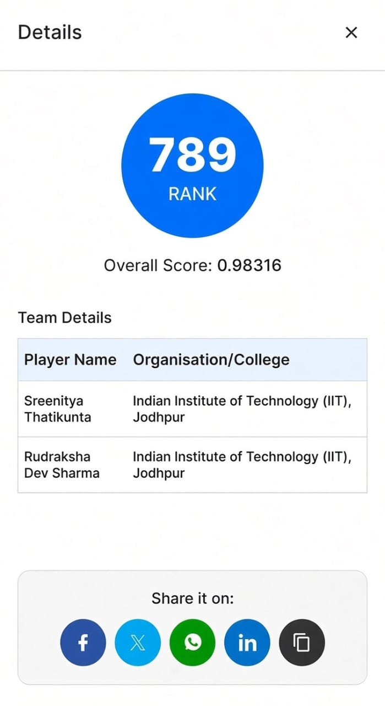
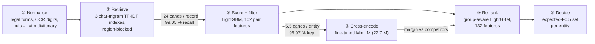

# Business Entity Resolution at Scale (Amazon ML Challenge 2026)

[](https://github.com/SreenityaThatikunta/amazon-ml-challenge/actions/workflows/tests.yml)


A pipeline that matches **10 million noisy business records** from two messy sources to the **1.7 million
real-world businesses** they describe, across the US, India and an unseen third country (France).

**Result: rank 789 of 20,000+ teams (top 4 %), public leaderboard macro F0.5 = 0.98316** (validation 0.99078).
Team *pootato*: [Sreenitya Thatikunta](https://github.com/SreenityaThatikunta) and
[Rudraksha Dev Sharma](https://github.com/RudrakshaSh).

<p align="center">
  
</p>

## The problem

Source 1 (S1) is a deduplicated list of businesses. Sources 2 and 3 hold noisy copies of them, mixed with records
that match nothing. For every S1 entity, find all of its S2/S3 records. The noise makes this hard:

- **Names:** abbreviations, legal forms, typos, OCR damage, aliases, Indian scripts, and some names replaced by made-up brands.
- **Addresses:** abbreviated, reordered, partial; house numbers truncated or shifted.
- **Deliberate traps:** lookalike records with one letter changed or the house number a few units off.
- **Precision-weighted metric:** macro F0.5 per entity, so a false merge costs twice as much as a miss.
- **Distribution shift:** training covers the US and India; the test set adds France with no labels, and is denser than training.

## Approach

A six-stage cascade that never compares every record with every entity:



1. **Normalisation tuned to the measured noise:** legal forms, OCR digits, injected IDs and phone numbers, filler
   words learned without labels, and a learned Indian-script → Latin dictionary (95.8 % exact-token match).
2. **Retrieval:** character-trigram TF-IDF over name, address and both, searched only within a learned
   neighbourhood of the record's region. **99.05 % pair recall** at ~24 candidates per record.
3. **Learned blocking:** a LightGBM pair scorer is both the first matcher and the last filter. It cuts candidates
   to **5.53 per entity** while keeping 99.97 % of the true pairs retrieved.
4. **Cross-encoder as a second opinion:** a 22.7 M-parameter MiniLM reads both records side by side. Alone it is
   weaker than LightGBM (AUC 0.975 vs 0.999), but *how much it prefers a candidate over its rivals* is a strong signal.
5. **Group-aware re-ranking (largest single gain):** a second LightGBM sees every record competing for the same
   entity. It is trained on whole held-out states, and density-dependent features are rescaled per country because
   the test set is more crowded than training.
6. **Decision:** one owner per record, then the subset that maximises expected F0.5 for each entity, plus a
   label-free correction for a French name-change pattern, estimated from house numbers in unlabelled test data.

## Results

| Version | Key change | Validation F0.5 | Public LB |
|---|---|---:|---:|
| prototype | inverted-index blocking + LightGBM | n/a | 0.961 |
| v1 | region-blocked TF-IDF, LightGBM pair scorer, expected-F0.5 decision | 0.98211 | 0.975 |
| v2.1 | stage-2 re-ranker that sees each entity's competing records | 0.98895 | 0.977 |
| v2.2 | per-country rescaling for the denser test set | 0.98897 | 0.980 |
| v2.6 | re-ranker trained on complete held-out groups; France prior correction | 0.98918 | 0.982344 |
| **v2.7** | **+ cross-encoder margins as re-ranker evidence (final)** | **0.99078** | **0.98316** |

Validation uses 222,624 entities in whole held-out US/Indian states; with every state unseen by the model that
scores it, F0.5 is 0.98988. The full write-up, with ablations and error analysis, is in
[docs/methodology.md](docs/methodology.md).

### What we learned

- **Validation gains don't transfer when the test distribution shifts.** One version raised validation by +0.007
  and *lowered* the leaderboard (0.975 → 0.972). Rescaling 20 density-dependent features changed validation by
  +0.00002 and raised the leaderboard by +0.003. Modelling the shift mattered more than chasing validation.
- **Context beats pairwise similarity.** Knowing who else claims an entity separates a true match from the
  lookalike next to it far better than any single-pair feature.
- **A weak model can still be a useful feature.** The cross-encoder never beat LightGBM on its own, but its
  relative margins added +0.0016 on validation.

## Experiments and branches

Every line of work is preserved on its own branch, each with a README that states what it tried and how it scored.

| Branch | What it explores | Public LB |
|---|---|---:|
| **`main`** | final pipeline, cleaned up | **0.98316** |
| [`experiment/v2.7-cross-encoder`](https://github.com/SreenityaThatikunta/amazon-ml-challenge/tree/experiment/v2.7-cross-encoder) | raw development history of the final version | 0.98316 |
| [`experiment/v2-group-reranker`](https://github.com/SreenityaThatikunta/amazon-ml-challenge/tree/experiment/v2-group-reranker) | stage-2 re-ranker, density rescaling, France anchor correction (v2.1–v2.6) | 0.982344 |
| [`experiment/v3-test-shaped-validation`](https://github.com/SreenityaThatikunta/amazon-ml-challenge/tree/experiment/v3-test-shaped-validation) | test-shaped validation, orphan copy groups, leave-one-country-out France rehearsal | 0.9805 |
| [`experiment/v1-lightgbm-baseline`](https://github.com/SreenityaThatikunta/amazon-ml-challenge/tree/experiment/v1-lightgbm-baseline) | first full pipeline, synthetic French data, cluster rescoring | 0.975 |
| [`archive/initial-prototype`](https://github.com/SreenityaThatikunta/amazon-ml-challenge/tree/archive/initial-prototype) | first quick baseline | 0.961 |

Each leaderboard submission is also tagged (`v1-lb0.975` … `v2.7-lb0.98316`).

## Repository layout

```
.
├── code/business_entity_resolution/
│   ├── README.md              technical README: architecture, reproduction, configuration
│   ├── requirements.txt       pinned dependencies
│   └── src/
│       ├── ber/               the pipeline package (python -m ber <stage>)
│       ├── tests/             pytest suite (runs without the challenge data)
│       └── tools/             license check, submission zip builder, cross-encoder training scripts
├── docs/methodology.md        full methodology: every experiment, ablation and error analysis
├── eda/                       exploratory analysis scripts and FINDINGS.md
└── assets/
```

## Running it

The challenge data is not included. Place the challenge `dataset/` folder (with `train/` and `test/`) in the
repository root. You need Python 3.12+, about 16 GB of RAM, and an NVIDIA GPU for the cross-encoder.

```bash
pip install -r code/business_entity_resolution/requirements.txt
export PYTHONPATH="$PWD/code/business_entity_resolution/src" PYTHONUTF8=1

for s in split normalize candidates features features-hold scorer crossenc rerank decide submit; do
    python -m ber $s --run main || break
done
```

A full run takes about 11 hours on one machine with a single consumer GPU and writes `output/matching_results.tsv`
and `output/candidate_pairs.tsv`. The submitted files are attached to the
[`v2.7-lb0.98316` release](https://github.com/SreenityaThatikunta/amazon-ml-challenge/releases/tag/v2.7-lb0.98316).
To run only the tests (no data needed):

```bash
python -m pytest code/business_entity_resolution/src/tests
```

See the [technical README](code/business_entity_resolution/README.md) for per-stage details.

## Team

- **Sreenitya Thatikunta:** EDA; the `ber` pipeline framework (config, artifacts, CLI); geographic split,
  normalisation and the Indic transliteration dictionary; TF-IDF retrieval, pair features, LightGBM scorer and
  expected-F0.5 decision (v1); France proxy and lookalike features; v3 test-shaped validation and France rehearsal.
- **Rudraksha Dev Sharma:** initial prototype; memory-bounded v2 rebuild; the group-aware stage-2 re-ranker, density
  rescaling and France anchor correction; the cross-encoder stage (v2.7); final submission package.

## License

MIT (see [LICENSE](LICENSE)). The cross-encoder checkpoint (`cross-encoder/ms-marco-MiniLM-L-6-v2`) is Apache-2.0.
The challenge data is not included.
