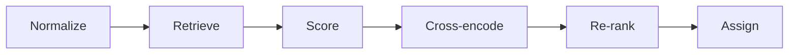

# Business Entity Resolution (team pootato, Amazon ML Challenge 2026)

This pipeline links every noisy business record from two secondary sources (S2, S3) to the
entity it describes in a deduplicated reference source (S1), across the US, India and
France, a country that appears only in the test data. Character-trigram retrieval and a
learned filter cut the search to 5.5 candidates per entity while keeping 99 % of the true
matches; a group-aware LightGBM re-ranker, informed by a fine-tuned transformer
cross-encoder, then decides. It reaches a macro F0.5 of **0.99078** on held-out states and
**0.98316** on the public leaderboard.

| Metric | Value |
|---|---|
| Validation macro F0.5 (222,624 S1 entities in whole held-out states) | **0.99078** |
| Public leaderboard F0.5 | **0.98316** |
| Candidate recall (true pairs kept in `candidate_pairs.tsv`, validation) | **99.02 %**, with 5.53 candidates per S1 on test |
| Runtime / hardware | ≈ 11 h end to end on one laptop (16 threads, 16 GB RAM, NVIDIA RTX 4050 with 6 GB) |



## Problem

S1 is a deduplicated list of businesses; S2 and S3 hold independent, noisy copies of them
mixed with unrelated records. For every S1 entity the task is to list its S2/S3 records.
Names vary through abbreviations, legal forms, typos, OCR errors, aliases, trade names and
Indian-script transliterations; addresses through abbreviations, missing or reordered
parts and altered house numbers; lookalike decoys (same name and street, house number off
by a few units) are planted on purpose. The score is macro F0.5 per S1 entity, so
precision counts twice as much as recall and an entity without matches must be predicted
empty. Training data covers the US and India; the test set (1.73 M S1, 10 M S2/S3 records)
adds France, for which no labels exist.

## Solution and innovation

- **Noise-aware normalisation.** Legal forms, OCR digits, aliases, injected ids and phone
  numbers are handled by rules; filler words are learned from the data; Indian-script
  names are romanised with a dictionary learned from training pairs; regions (states,
  codes, French départements) are extracted from addresses.
- **Small candidate sets without losing recall.** Three character-trigram TF-IDF indexes
  (name, address, both) are searched within a learned neighbourhood of the record's region
  (99.05 % of true pairs retrieved). A LightGBM scorer on 102 pair features then serves as
  the final, learned blocking filter: 5.53 candidates per S1 remain and 99.97 % of the
  retrieved true pairs survive.
- **Transformer evidence where it is strong.** A 22.7 M-parameter MiniLM cross-encoder,
  fine-tuned only on pairs the scorer never trained on, reads both records jointly. On its
  own it is the weaker matcher (AUC 0.975 against 0.999), but its margin over the
  competing candidates is strong evidence for the re-ranker.
- **Group-aware re-ranking.** A second LightGBM sees the competition for each S1 entity
  (how many records claim it, how strongly, from which source) together with the
  cross-encoder margins. It is trained on whole held-out states whose S1 groups are
  complete, as every group is at test time, and its size-dependent features are
  normalised per country and split, because the test set is denser than the training set.
- **Decision.** Each record gets one owner; for each S1 the set of records with the
  highest expected F0.5 is kept. A label-free correction, estimated from house-number
  evidence in the unlabelled test data, handles a French name-change pattern that the
  training countries do not have.

## Results

| Evaluation | Macro F0.5 |
|---|---|
| Validation: 222,624 S1 in whole held-out states | **0.99078** |
| US / India | 0.99147 / 0.98970 |
| S1 entities without a true match | 0.99343 |
| Validation with every state unseen by the model that scores it | 0.98988 |
| Public leaderboard | **0.98316** |

Pair precision on validation is 0.99898 and pair recall 0.97408. Ablations, error analysis
and the reasoning behind each design decision are in `Documentation_template.md`, at the
root of the submission package.

## Architecture

| Step | Stages | Code | What it does |
|---|---|---|---|
| Normalize | `split`, `normalize` | `eval/split.py`, `normalize/` | Geographic train/validation split (whole states); canonical names, legal forms, addresses and regions |
| Retrieve | `candidates` | `candidates/` | Region-blocked character-trigram TF-IDF, top 10 per index |
| Score | `features`, `features-hold`, `scorer` | `features/`, `scorer/` | 102 pair features and the LightGBM scorer; pairs with p ≥ 0.001 form `candidate_pairs.tsv` |
| Cross-encode | `crossenc` | `crossenc/` | Fine-tunes the MiniLM cross-encoder and scores every candidate pair |
| Re-rank | `rerank` | `rerank/` | Cross-fitted LightGBM with S1-group context and cross-encoder margins |
| Assign | `decide`, `submit` | `decide/`, `submit.py` | One owner per record, expected F0.5 per S1, prior correction; writes `output/` and runs the official validator |

Each stage runs as `python -m ber <stage> --run <run>`, reads the previous stage's
artifacts from `artifacts/<run>/<stage>/` and writes its own, with a `manifest.json`
recording the configuration hash, git commit, timings, peak memory and metrics. Every
parameter lives in [`src/ber/configs/default.yaml`](src/ber/configs/default.yaml), which is
the submitted configuration.

## Reproducibility

### Quick start

Requirements: Python 3.11–3.13, 16 GB RAM, an NVIDIA GPU with at least 6 GB for the
cross-encoder. Run from the directory that contains `dataset/` (with `train/` and `test/`)
and this `code/` folder.

```bash
python -m venv .venv && source .venv/bin/activate   # Windows: .venv\Scripts\activate
pip install -r code/business_entity_resolution/requirements.txt
export PYTHONPATH="$PWD/code/business_entity_resolution/src"   # Windows: set PYTHONPATH=%CD%\code\business_entity_resolution\src
export PYTHONUTF8=1

for s in split normalize candidates features features-hold scorer crossenc rerank decide submit; do
    python -m ber $s --run main || break
done
```

This writes `output/matching_results.tsv` and `output/candidate_pairs.tsv` and checks them
with the official validator. Run the stages one at a time, as several need 8–10 GB of RAM.
`python -m pytest code/business_entity_resolution/src/tests` checks the installation, and
`python -m ber explain <entity_id> --run main` traces one record through every stage.

The cross-encoder of the submitted file was trained with the scripts in
[`src/tools/crossenc_prototype/`](src/tools/crossenc_prototype/README.md), the same
procedure as the `crossenc` stage. GPU training is not bit-for-bit deterministic, so a re-run gives a very
close but not identical file. Per-stage runtime and memory, running the training and test
sides separately, and the main configuration options are described in
`Documentation_template.md`, Appendix C.

## Repository structure

```
code/business_entity_resolution/
├── README.md
├── requirements.txt              every dependency, pinned
└── src/
    ├── ber/                      the pipeline package (python -m ber <stage>)
    │   ├── cli.py, config.py, artifacts.py, io.py, log.py, explain.py, submit.py
    │   ├── configs/              default.yaml (the submitted configuration), dev.yaml
    │   ├── eval/                 geographic split, macro F0.5
    │   ├── normalize/            names, addresses, regions, transliteration, lookup tables
    │   ├── candidates/           TF-IDF retrieval (CPU or GPU)
    │   ├── features/             pair features
    │   ├── scorer/               LightGBM scorer and learned filter
    │   ├── crossenc/             transformer cross-encoder
    │   ├── rerank/               group-aware re-ranker
    │   └── decide/               one owner per record, expected F0.5, prior correction
    ├── tests/                    pytest suite
    └── tools/
        ├── check_licenses.py     dependency license audit
        ├── make_submission_zip.py  builds the submission zip
        ├── validate_submission.py  copy of the official validator (used by the submit stage)
        └── crossenc_prototype/   the scripts that trained the submitted cross-encoder
```

## Team and license

- Team **pootato**: Sreenitya Thatikunta, Rudraksha Dev Sharma.
- Code: MIT License.
- Dependencies: MIT, BSD, Apache-2.0 or PSF licenses, audited by `src/tools/check_licenses.py`
  (two MPL-2.0 packages, `tqdm` and `certifi`, are used unmodified).
- Model: `cross-encoder/ms-marco-MiniLM-L-6-v2`, Apache-2.0, 22.7 M parameters (the
  challenge allows MIT or Apache-2.0 models up to 8 B parameters).
- Data: only the challenge's training and test files. No external data sources, lookups
  or APIs are used; the only external artefact is the pretrained cross-encoder checkpoint.
