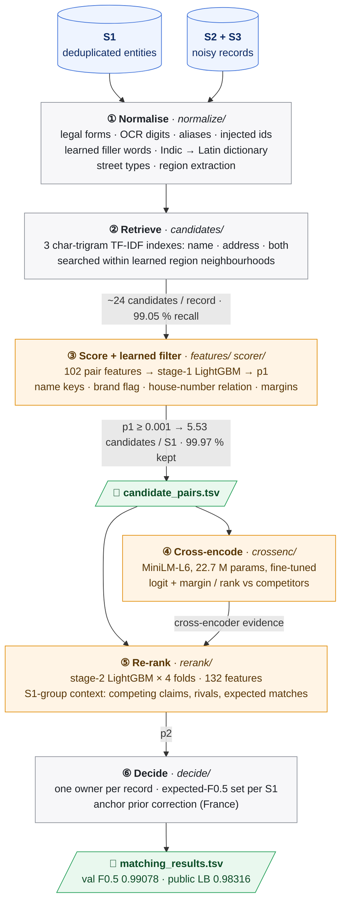
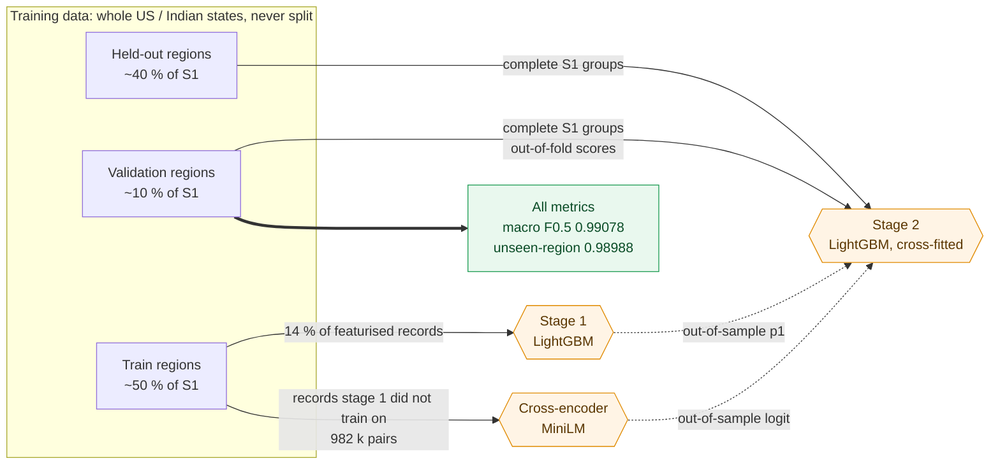

# Business Entity Resolution (team pootato, Amazon ML Challenge 2026)

tl;dr: we take messy business records and figure out which real business each one belongs to.
- **The data.** One clean, deduplicated reference list (S1) and two noisy side sources (S2, S3). It covers the US and India, plus France, which only shows up in the test set (surprise).
- **How it works.** Character-trigram retrieval and a learned filter cut the search down to about 5.5 candidates per entity while keeping 99 % of the real matches. Then a LightGBM re-ranker that can see the competition makes the final call, with a fine-tuned transformer cross-encoder feeding it hints.
- **How well it does.** Macro F0.5 of **0.99078** on held-out states and **0.98316** on the public leaderboard. Not bad, ngl.

| Metric | Value |
|---|---|
| Validation macro F0.5 (222,624 S1 entities in whole held-out states) | **0.99078** |
| Public leaderboard F0.5 | **0.98316** |
| Candidate recall (true pairs kept in `candidate_pairs.tsv`, validation) | **99.02 %**, with 5.53 candidates per S1 on test |
| End-to-end runtime | ≈ 11 h with a single CUDA GPU |



## The problem (aka why this is harder than it looks)

S1 is a deduplicated list of businesses. S2 and S3 each have their own noisy copies of those businesses, mixed in with records that don't match anything at all. For every S1 entity, we have to find all of its S2 and S3 records.

Why it's lowkey hard:
- **Names get mangled.** Abbreviations, legal forms, typos, OCR errors, aliases, trade names, and names written in Indian scripts. Basically every way a name can go wrong.
- **Addresses get mangled too.** Abbreviations, missing or reordered parts, and changed house numbers.
- **Some records are straight-up traps.** Lookalikes share a real entity's name and street, but the house number is a few units off. Very sus.
- **Precision is the main character.** The metric is macro F0.5 per S1 entity, so precision counts twice as much as recall, and an entity with no matches has to be predicted empty.
- **The test set plays by different rules.** Training covers the US and India. The test set (1.73 M S1, 10 M S2/S3 records) adds France, with zero labels.

## Our approach

- **Clean the text, noise-aware.**
  - Rules handle legal forms, OCR digits, aliases, and ids and phone numbers pasted into names.
  - Filler words are learned from the data.
  - Indian-script names are romanised with a dictionary learned from training pairs.
  - Regions (states, state codes, French départements) get pulled out of addresses.
- **Keep the candidate set tiny without losing matches.**
  - Three character-trigram TF-IDF indexes (name, address, both) are searched near the record's region. Together they find 99.05 % of true pairs.
  - A LightGBM scorer on 102 pair features then acts as the final blocking filter. 5.53 candidates per S1 are left, and 99.97 % of the true pairs we retrieved make it through.
- **Let the transformer cook, but only where it's good.**
  - A 22.7 M-parameter MiniLM cross-encoder reads both records together. We fine-tune it only on pairs the scorer never trained on.
  - As a matcher on its own it's kinda mid (AUC 0.975 vs 0.999). But how far ahead it rates a pair versus the competing candidates? That turns out to be a seriously strong hint for the re-ranker.
- **Re-rank with the competition in view.**
  - A second LightGBM sees who else is competing for each S1 entity: how many records claim it, how strongly, and from which source. It also gets the cross-encoder's margins.
  - It trains on whole held-out states where every entity's records are all present, just like at test time.
  - Features that depend on how crowded the data is get rescaled per country and split, because the test set is denser than training.
- **Make the final call.**
  - Each record gets one owner. Then, for each S1, we keep the set of records with the highest expected F0.5.
  - France has a kind of name change the US and India don't. A correction estimated from house numbers in the unlabelled test data handles it.

## Results

| Evaluation | Macro F0.5 |
|---|---|
| Validation: 222,624 S1 in whole held-out states | **0.99078** |
| US / India | 0.99147 / 0.98970 |
| S1 entities without a true match | 0.99343 |
| Validation with every state unseen by the model scoring it | 0.98988 |
| Public leaderboard | **0.98316** |

Pair precision on validation is 0.99898 and pair recall is 0.97408. Ablations, error analysis and the why behind every design decision live in `Documentation_template.md`, at the root of the submission package.

### How we got here

| Version | Key idea | Validation | Public LB |
|---|---|---:|---:|
| v1 | TF-IDF blocking, LightGBM pair scorer, expected-F0.5 decision | 0.98211 | 0.975 |
| v2.1 | stage-2 re-ranker that sees each S1's competing records | 0.98895 | 0.977 |
| v2.2 | per-country, per-split rescaling (the test set is denser) | 0.98897 | 0.980 |
| v2.4–v2.6 | re-ranker trained on held-out states with complete S1 groups; French prior correction | 0.98918 | 0.982344 |
| **v2.7** | **+ MiniLM cross-encoder margins as re-ranker evidence** | **0.99078** | **0.98316** |

We also tried a bunch of other stuff in separate branches. It's all written up, with numbers, in `Documentation_template.md`, Appendix C:
- Rudraksha's first baseline, an inverted index over IDF-weighted keys;
- a separate model for unseen countries, trained on synthetic French data;
- test-shaped validation, and rehearsing France by leaving one country out;
- pseudo-labelling;
- an LLM that picks among the top candidates (designed, but never trained).

None of the code for the ideas we dropped is in this package.

## Architecture

Every model gets scored on data it never trained on. We split by whole US and Indian states, so lookalikes land on the same side as the entities they copy. No accidental leakage.



| Step | Stages | Code | What it does |
|---|---|---|---|
| Normalize | `split`, `normalize` | `eval/split.py`, `normalize/` | Splits train/validation by whole states; cleans names, legal forms, addresses and regions |
| Retrieve | `candidates` | `candidates/` | Region-blocked character-trigram TF-IDF, top 10 per index |
| Score | `features`, `features-hold`, `scorer` | `features/`, `scorer/` | 102 pair features and the LightGBM scorer; pairs with p ≥ 0.001 make up `candidate_pairs.tsv` |
| Cross-encode | `crossenc` | `crossenc/` | Fine-tunes the MiniLM cross-encoder and scores every candidate pair |
| Re-rank | `rerank` | `rerank/` | Cross-fitted LightGBM with S1-group context and the cross-encoder's margins |
| Assign | `decide`, `submit` | `decide/`, `submit.py` | One owner per record, expected F0.5 per S1, prior correction; writes `output/` and runs the official validator |

How the stages fit together:
- You run each stage as `python -m ber <stage> --run <run>`.
- Each stage reads the previous one's output from `artifacts/<run>/<stage>/` and writes its own there.
- Every stage also drops a `manifest.json` with the config hash, git commit, timings, peak memory and metrics, so every run is traceable.
- All parameters live in [`src/ber/configs/default.yaml`](src/ber/configs/default.yaml), which is our submitted configuration.

## Reproducing the results

### Quick start

You'll need:
- Python 3.12 or 3.13 (the pinned numpy and scipy need at least 3.12);
- a CUDA-capable GPU for the cross-encoder (the CPU build works, it's just slow);
- to run everything from the directory that contains `dataset/` (with `train/` and `test/`) and this `code/` folder.

```bash
python -m venv .venv && source .venv/bin/activate   # Windows: .venv\Scripts\activate
pip install -r code/business_entity_resolution/requirements.txt
export PYTHONPATH="$PWD/code/business_entity_resolution/src"   # Windows: set PYTHONPATH=%CD%\code\business_entity_resolution\src
export PYTHONUTF8=1

for s in split normalize candidates features features-hold scorer crossenc rerank decide submit; do
    python -m ber $s --run main || break
done
```

That writes `output/matching_results.tsv` and `output/candidate_pairs.tsv`, and checks both with the official validator.

Two commands you'll actually use:
- `python -m pytest code/business_entity_resolution/src/tests` checks that everything installed correctly.
- `python -m ber explain <entity_id> --run main` follows one record through every stage.

Good to know:
- Run the stages one at a time; a few of them want 8–10 GB of RAM.
- The cross-encoder behind the submitted file was trained with the scripts in [`src/tools/crossenc_prototype/`](src/tools/crossenc_prototype/README.md). Same procedure as the `crossenc` stage.
- GPU training isn't bit-for-bit deterministic, so a re-run gives you a very close file, not an identical one.
- Runtime and memory per stage, running the training and test sides separately, and the settings that matter are all in `Documentation_template.md`, Appendix D.

## Repository structure

```
code/business_entity_resolution/
├── README.md
├── requirements.txt              every dependency, pinned
└── src/
    ├── ber/                      the pipeline package (python -m ber <stage>)
    │   ├── cli.py, config.py, artifacts.py, io.py, log.py, explain.py, submit.py
    │   ├── configs/              default.yaml (the submitted configuration), dev.yaml
    │   ├── eval/                 geographic split, macro F0.5
    │   ├── normalize/            names, addresses, regions, transliteration, lookup tables
    │   ├── candidates/           TF-IDF retrieval (CPU or GPU)
    │   ├── features/             pair features
    │   ├── scorer/               LightGBM scorer and learned filter
    │   ├── crossenc/             transformer cross-encoder
    │   ├── rerank/               group-aware re-ranker
    │   └── decide/               one owner per record, expected F0.5, prior correction
    ├── tests/                    pytest suite
    └── tools/
        ├── check_licenses.py     dependency license audit
        ├── make_submission_zip.py  builds the submission zip
        ├── validate_submission.py  copy of the official validator (used by the submit stage)
        └── crossenc_prototype/   the scripts that trained the submitted cross-encoder
```

## Team and license

- Team **pootato**: Sreenitya Thatikunta and Rudraksha Dev Sharma.
- Our code is under the MIT License.
- Every dependency is MIT, BSD, Apache-2.0 or PSF, which `src/tools/check_licenses.py` checks. Two MPL-2.0 packages, `tqdm` and `certifi`, are used unmodified.
- The model is `cross-encoder/ms-marco-MiniLM-L-6-v2` (Apache-2.0, 22.7 M parameters). The challenge allows MIT or Apache-2.0 models up to 8 B parameters.
- We only used the challenge's training and test files: no external data, lookups or APIs. The only outside artefact is the pretrained cross-encoder checkpoint.
